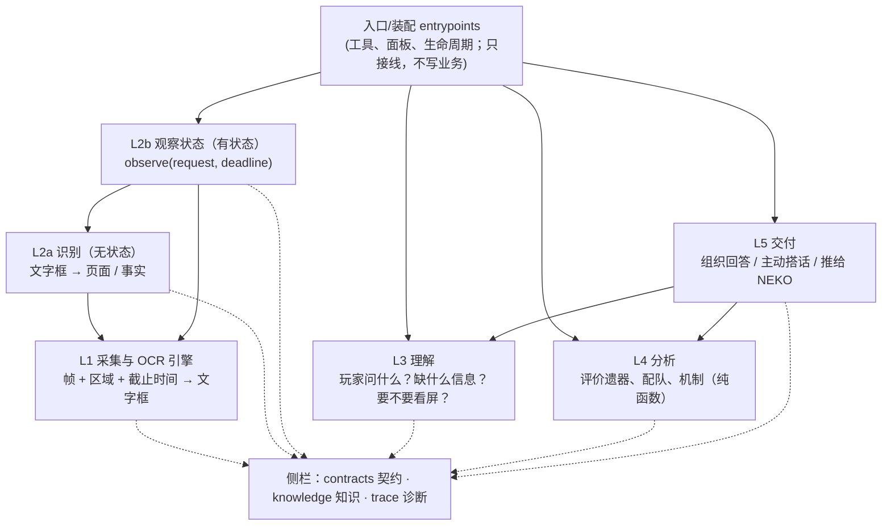

# ARCHITECTURE.md —— hsr_companion 目标架构<br>（v2，2026-11-16）

> 本文是"要往哪里改"的设计，不是"现在长什么样"。
>
> 现状事实（文件行数、行号）出自对 main（v0.9.6，提交 921f3cf）的两次审读，行号都指 main。
>
> 旧版 ARCHITECTURE.md（按补丁日期叠加的那份）整份被本文取代，历史补丁说明请移到 `docs/CHANGELOG.md`。
>
> 标 ★ 的数字都是暂定值，要在真机上实测后由作者确认（汇总见第 9 节）。
>
> v2 相对 v1 的变化：总预算定为 8 秒；分路规则改为"按问题缺的信息能否从当前画面补齐"，不再按话题分；超时策略已定（给"X 秒前的画面"，无旧读数就说看不清），补答 / 事后更正先删；第 9 节只剩要真机实测的数字。

## 0. 一句话版本

猫娘问问题时，插件**先看问题缺不缺信息**：信息齐全就直接走知识和聊天，不碰 OCR；缺对象或缺场景，就**先用后台页面探测确定场景，再现场截一张图、只读被问的那一小块**，几秒内回答，并如实说"这是多久前的画面"；屏幕上也补不上，就追问玩家一句。

## 1. 目标与设计原则

**大白话：** 玩家问一句，猫娘要像平时聊天一样几秒内回话。所以别再"后台一直读整屏、提问时去等"，改成"提问时才看、只看一小块、看不清就老实说"。

**目标：** 插件这部分的总预算是 **8 秒**（已定；NEKO 自身调用回复就约 12 秒，没必要压得更紧），不含 NEKO 说话的时间；绝不把旧画面说成新画面；新增一种页面或玩法时，只改一处，不牵动全部。

**四条原则：**

1. **只往下调。** 上层可以调用下层，下层不许 import 上层，也不许"回头问上层要状态"。这条规则由测试强制执行（见第 8 节），不靠自觉。
2. **总截止时间像 TTL 一样往下传。** 一次提问在入口创建一个 `Deadline`，每层只看 `deadline.remaining()`，不再各自写 2 / 2.5 / 8 / 20 / 22 / 30 / 35 秒。
3. **按"问题缺的信息能否从当前画面补齐"分流，不按话题分。** 信息齐全的问题永远不排队等 OCR；缺的信息画面能补，就现场看一小块；画面也补不上，就追问玩家，不猜（第 4 节）。
4. **诚实标注新鲜度。** 每个回答都带"读取时刻"；用的是旧数据就明说多久前；没有任何可用观察才说看不清。这条是现有项目已经做得好的"不乱说"传统，要保持。

**两条硬约束（来自作者的需求）：**

- 提问路径上**不允许整屏 OCR**（实测 15–22 秒，必然超预算）。整屏只能出现在后台或玩家明确愿意等的低频场景。
- 同一时刻只允许一个 OCR 在跑；新问题顶掉旧问题，而不是排在后面。

## 2. 五层 + 侧栏总览

**大白话：** 数据像流水线一样从下往上走：先拿到图（L1），再认出图里是什么（L2），再弄懂玩家问什么（L3），再算出建议（L4），最后组织成话交给猫娘（L5）。有三个"公共小仓库"（侧栏）谁都能用，但它们自己不依赖任何层。

### 2.1 依赖图



读图方法：实线 = 允许调用；虚线 = 谁都可以用侧栏。**没画线 = 不许依赖。**

特别注意：L3、L4 都**不 import L2**。它们只认 `contracts` 里的数据类型（`ObservationResult`、`ScreenFacts`、`QueryPlan`），这样 L3/L4 才能做成可单测的纯函数库。

把 L2 的结果送给 L3/L4 的是入口里的"提问流水线"（第 4 节），它是唯一允许同时认识各层的地方。

### 2.2 与旧五层草案相比改了三处

| 改动 | 原因 |
| --- | --- |
| L2 拆成 2a 识别 + 2b 观察状态，仍算同一层 | 现在 `detectors/` + `screen_facts` 基本就是 2a（无状态规则），`runtime/` 里约 12 个文件是 2b（有状态）。拆开后识别规则可以只用一张截图测试，不用启动整个观察器 |
| L1 只收"帧 + 区域 + 截止时间"，只回"文字框" | 现在 `adapters/` 里的 `text_verification`、`relic_values`、`navigation_reader`、`local_vision.analyze` 都带领域规则，应上移到 L2a。L1 不认识遗器、角色、页面 |
| 新增侧栏包：`contracts`、`knowledge`、`trace` | 它们被任意层引用，放进某一层就必然有人"越层"。`contracts` 里放状态词表、`Deadline`、`ReadSubject`、`QueryPlan`、事实类型 |

不另设第六层；`ObservationState` 不单独成层，它是 L2b 内部的一个对象。L3 与 L4 不合并。

## 3. 各层职责与归属

**大白话：** 每层一句话说清"管什么、不管什么"。判断一段代码该放哪层，就问：**什么需求出现时这段代码要改？** 换 OCR 模型 → L1；新增一种页面 → L2a；玩家换了问法 → L3；遗器评价口径变了 → L4；猫娘措辞变了 → L5。

> **关于目录：** 不必先搬文件。第一步是在仓库里放一份 `layers.toml`（"模块 → 层"的声明），分层测试按它检查依赖；文件什么时候搬，随迁移步骤慢慢来。

### 3.1 侧栏（不是层）

| 包 | 放什么 | 规则 |
| --- | --- | --- |
| `contracts` | 状态词表（第 5 节）、`Deadline`、`ReadSubject`（要读什么）、`ReadRequest`、`ObservationResult`、`ScreenFacts`、`QueryPlan`、`SCREEN_FIELDS` | 可以放数据类型、常量及无状态的纯函数；不执行 I/O，不 import 其他层（允许依赖同属 contracts 的模块） |
| `knowledge` | `data/`（资料包、头像包、`catalog`）、`core.KnowledgeBase`、`resources/*.json`（含新增 `phrases.json`） | 只读。⚠ `data/pack.py`（下载 + 校验 + sqlite 读取混在一起）要拆；`avatar_pack.py` 里的 SIFT 匹配属识别能力，应归 L2a |
| `trace` | `prepare_trace`、`diagnostics`、`revocation_trace`、`page_control_trace`、`vision_trace` 等 | 只写不读业务状态；不记游戏文字和图像（保持现有隐私约定） |

### 3.2 L1 采集与 OCR 引擎

- **职责：** 找到游戏窗口、截图、给帧打时间戳；按"区域 + 截止时间"跑 OCR，返回文字框（文字 + 坐标 + 置信度）。
- **能依赖：** 只有侧栏（`Deadline`、`trace`）。
- **不许做：** 不认识页面、遗器、角色；不判断"这张图是什么页面"；不 import L2 及以上；不做下载安装。
- **契约：** 超过截止时间就**不开下一块**（单次 OCR 原生调用不可打断，所以只能在块与块之间检查）。
- **同一时刻只有一个 OCR**，带检查点，新请求到来时旧请求在检查点退出。

| 现有文件 | 去向 |
| --- | --- |
| `assistant_runtime/server.py`、`window_capture.py`（独立进程，只监听 127.0.0.1） | L1，原样保留 |
| `observer.py`、`vision.py` | L1 |
| `adapters/upright_ocr.py`、`ocr_work_queue.py` | L1 |
| `assistant.py` | ⚠ 要拆：71–224 的助手 HTTP 客户端留 L1；226–518 的进程管理 + 下载 / SHA256 / 解压安装拆成 `installer`（供应链逻辑，与采集无关） |
| `adapters/text_reader.py` | ⚠ 要拆：分块 OCR 循环（`read_native_text`）留 L1；函数内用 `detectors.names` / `PAGE_RULES` 决定"要不要重读"的部分上移 L2a |
| `session.visual_fingerprint`（图像哈希） | 搬到 L1 工具 |
| `runtime/query_reuse.region_stamp` / `regions_changed`（像素工具） | 搬到 L1 工具 |

### 3.3 L2a 识别（无状态）

- **职责：** 输入"文字框 + 缩略图"，输出"这是什么页面、里面有哪些事实"；并提供"页面 → 要读哪些区域"的区域表（L3 只说"我要看遗器面板"，几何由这里负责）。区域表里每个页面还标明是静态页还是实时页，决定提问时走路线 A 还是 B（见 4.2）。
- **能依赖：** L1、`knowledge`、`contracts`。
- **不许做：** 不持有状态（没有"上一帧"）；不知道玩家问了什么；不写 `getattr(owner, ...)`。
- **新增页面 / 玩法 = 在这里加一条页面规则 + 一条区域表项**，别处不用动。

| 现有文件 | 去向 |
| --- | --- |
| `detectors/*`（layout、exploration、team、scene、names、relic_geometry、page_catalog、character、relic_labels；约 1200 行纯规则） | L2a，基本不动 |
| `runtime/screen_facts.py` | 搬出 runtime 进 L2a（现在被 adapters 反向引用）。⚠ 391 行附近对 `equipment.equipment_card` 的调用要去掉 |
| `adapters/text_verification.py`、`relic_values.py`、`navigation_reader.py` | L2a（领域规则） |
| `adapters/local_vision.py` | ⚠ 要拆：后端选择 + 串行锁（约前 150 行）留 L1；`analyze`（316–520，串起版面→遗器→头像→队伍→事实）改名为 `PageReader` 进 L2a，并改成"只读指定区域" |
| `data/avatar_pack.py` 的匹配部分 | L2a |
| `game_state.py` | L2a（页面状态词表）；5 分钟 TTL 常量并入时间预算表 |
| `detectors/scene_preview.py` | L2a，但它产出的只是"候选"，规则见 3.4 |

### 3.4 L2b 观察状态（有状态，对外只有一个入口）

- **职责：** 持有"现在看到了什么"（`ObservationState`，唯一主人）；对外只暴露 `observe(request: ReadRequest, deadline: Deadline) -> ObservationResult`。
- 负责：（缺场景时）先用页面探测确定当前场景 → 现场截图 → 调 L2a 读区域 → 收尾像素比对 → 判定 fresh / stale / unavailable；后台页面探测与预热（第 7 步以后）；撤销 / 暂停规则。
- **能依赖：** L2a、L1、`contracts`。
- **不许做：** 不理解玩家的话（不看 query 文字）；不拼给模型的文案；**L3 以上看不到任何 `_visual_query_waiters` 之类的内部字段**；不用 `getattr(owner, "_x", 默认)` 读写私有状态。
- **一条撤销铁律：** 没有控件证据（页面控件数 ≥ 1）不得撤销当前观察；缩略图预览只能记为"候选页面"。
- `ObservationState` **一个对象，内含五块：** `FrameGuards`（帧保护）、`Counters`（epoch / serial / 提问代次，只留一套）、`Leases`（字段租约）、`Jobs`（正在跑的读取）、`Waiters`（等待者）。**撤销 = 整体换一个新实例并 `epoch+1`**，不再手工清 25 个字段。

| 现有文件 | 去向 |
| --- | --- |
| `observation_store`、`observation_evidence`（当前画面证据）、`fact_lifecycle`、`delivery_scope`、`delivery_boundary`、`review_policy`、`query_reuse`、`page_handoff`、`manual_refresh`、`vision_scheduler` | L2b。其中后几个在新路径里会大幅瘦身（见第 10 节），不是原样搬 |
| `runtime/live_refresh.py`（1254 行） | ⚠ 要拆：取帧 → L1；像素比对 `frame_changed` → L1 工具；OCR 调度 + 复核 → L2b；`refresh_for_query` 的提问等待循环 → 删除，由 `observe()` 取代 |
| `__init__.py` 的 `_observer_loop`（约 340 行）、506–632 的观察状态封装、688–894 的 `_apply_local_analysis` | ⚠ 要拆：采集源选择 + 健康检查 → L2b；"commit 后投递主动事件"那一段 → L5 |
| `runtime/query_coordinator.resolve_query` 里的锁和 `create_task(refresh)` | 下沉到 `observe()` |

### 3.5 L3 理解

- **职责：** 把"玩家说的话 + 模型传的几个提示"变成一份 `QueryPlan`：问题信息齐全吗（齐全 → 不看屏；不齐全 → 缺什么：缺对象 / 缺场景，记在 `missing`）、看什么（`ReadSubject`）、需要哪些字段、问的是谁（指示词"这件 / 那套 / 这段"绑定到本帧）。
- **能依赖：** `contracts`、`knowledge`。**不 import L2。**
- **不许做：** 不截图、不 OCR、不等任何东西；模型传错参数时**不拒绝整轮**，按画面纠正并记一条 trace。
- **只留一套规划器（semantic）**；说法词表放 `resources/phrases.json`，新增说法只改数据。

| 现有文件 | 去向 |
| --- | --- |
| `query_plan`（只留 semantic）、`consultation_contract`、`semantic_guidance`、`pending_contract`、`request_completion` | L3 |
| `guidance.plan_guidance`（258–452，约 200 行关键词） | L3，词表外移；`build_guidance` / `team_options` 拆给 L4 |
| `query_coordinator` 的 `evaluate_readiness` / `answer_status` / `needs_followup` | L3 |
| `consultation` 的 `consultation_action` / `stated_equipment` / `condition_reply` | L3；`build_reply_plan` → L5 |
| `session.resolve_character_candidates`、`equipment_reply` 的"绑定玩家补数" | L3 |

### 3.6 L4 分析（纯函数）

- **职责：** 输入"事实 + 玩家档案 + 知识"，输出"评价 / 建议 / 配队思路"。
- **能依赖：** `contracts`、`knowledge`。**不 import L2、L3、L5。**
- **不许做：** 不读屏、不联网（UID 联网是 `uid_service`，属 L4 的"数据入口"，放在 `l4/ingest` 子目录并标明）；不拼措辞。

| 现有文件 | 去向 |
| --- | --- |
| `equipment.assess_*`、`mechanics`、`challenge`、`team_overview`、`progression`、`saved_cone`、`data_freshness`、`grounding`、`core.analyze_team` / `evaluate_event` | L4 |
| `equipment.equipment_card` / `equipment_readiness` / `equipment_object`（事实视图） | ⚠ 要拆回 L2b / `contracts` |
| `player_builds`、`uid_import`、`uid_service`、`adapters/showcase`、`core` 里的档案合并 | L4（数据入口子目录） |

### 3.7 L5 交付

- **职责：** 把分析结果变成猫娘能说的东西：工具返回的 payload、静默上下文、主动搭话；观察结果是 `unavailable` 且 `QueryPlan.missing` 非空时，组装成**一句追问**（见 4.2）。
- **能依赖：** L4、L3、`contracts`、`knowledge`。**不碰 L2 内部状态。**
- **不许做：** 不等 OCR（没有等待循环）；不判断画面新不新（这是 L2b 的 `ObservationResult.state`，L5 只"照实转述"）。
- **给模型的长篇 `instruction` 文案集中放 `prompts/`**，不再混在 `observation.py` 里。

| 现有文件 | 去向 |
| --- | --- |
| `answer_message`、`page_message`、`cone_message`、`service_contract`、`chat_activity` | L5 |
| `context_text`（被动上下文与路由提示） | L5 |
| `pending_reply`（兼容门面）、`pending_handler`（待办接话处理） | L5；数据类型与辅助函数放 L3 的 `pending_contract` |
| `consultation.build_reply_plan`、`equipment_reply` 的评价 + 回复包部分 | L5 |
| `followup.py`（537 行） | ⚠ 要拆：补答的等待循环 + 主动读取恢复整体删除（见 4.5）；仍被其它路径用到的消息渲染与推送留 L5 |
| 主动搭话子系统：`engine`、`arbiter`、`speech`、`delivery`、`contracts`（独立管线：稳定事件→仲裁→发声） | L5 子包 `proactive/`，输入改为 L2b 发布的"稳定事件" |
| `session.build_companion_context` | L5 |
| `observation.py` 里 187–205 的 instruction 文案 | → `l5/prompts/` |

### 3.7.1 0.9.8 P3 临时归属与待拆分欠账（2026-11-21）

`runtime/guidance.py` 与 `runtime/semantic_guidance.py` 当前同时承担 L3 需求理解、L4 建议构建和 L5 交付组织。P3 在 `layers.toml` 中将两文件暂归 L5，以容纳它们对 L3、L4 的现有依赖；职责拆分仍待完成，第 3.5、3.6 节的分工继续作为目标。

以下六条依赖从 import 越界白名单移出后，在本节继续按架构欠账跟踪。

| 待拆分模块 | 当前依赖的 L4 模块 |
| --- | --- |
| `runtime/guidance.py` | `runtime/challenge.py` |
| `runtime/guidance.py` | `runtime/data_freshness.py` |
| `runtime/guidance.py` | `runtime/equipment.py` |
| `runtime/guidance.py` | `runtime/mechanics.py` |
| `runtime/guidance.py` | `runtime/saved_cone.py` |
| `runtime/semantic_guidance.py` | `runtime/challenge.py` |

**退出计划**

- 在第 10 节迁移步骤 5 合并规划器时，按 `plan_guidance`、`build_guidance` 和 `team_options` 的实际职责拆分。需求理解归 L3，机制分析与建议归 L4，回答组织归 L5，由入口组合各层结果。
- 拆分覆盖函数内部依赖。`plan_guidance` 内部已有 `challenge_scope` 调用，处理时需要一起划清规划与分析的边界。
- 完成拆分、核对六条依赖各自的归属，并通过分层门及既有咨询、配队回归后，逐条销账。当前 import 基线减少六条，职责混合的欠账继续保留在此。

### 3.7.2 0.9.8 P4 兼容门面调整（2026-11-21）

为保留旧导入路径，`runtime/pending_reply.py` 归 L5，仅 re-export 六个旧名称。`handle_pending_reply` 的实现整体搬到 L5 的 `runtime/pending_handler.py`；`UserActivity`、`message_digest`、`activity_stamp`、`message_allows`、`relation_contract` 整体搬到 L3 的 `runtime/pending_contract.py`，内部调用按职责引用新文件。

原方案让旧文件留在 L3，若同时转接 L5 的处理函数，会新增 L3→L5 越界。因此采用兼容门面，六个旧名称与新路径保持同一对象，统一登记到 `tests/test_legacy_imports.py`。本次只删除原两条 import 白名单，预计 17→15，函数判断、截止时间和待办状态处理沿用原实现。

### 3.7.3 0.9.8 P5 观察与交付的兼容边界（2026-11-21）

`public_visual_evidence`、`VISUAL_TTL_SECONDS` 和证据状态词表放在 L2b 的 `runtime/observation_evidence.py`；`visual_context_text`、界面范围标签及 `SERVICE_ROUTING_RULE` 放在 L5 的 `runtime/context_text.py`，提示内容沿用原值。`service_contract.py` 继续 re-export 原路由提示名称。

旧 `runtime/observation.py` 只转接上述旧名称，归 entrypoints，以同时装配 L2b 证据与 L5 文案。L2b 内部改用证据实现文件。`query_coordinator` 对旧观察入口的既有越界继续登记在原白名单，留待 P7 下沉查询编排时处理。

`equipment_reply.try_equipment_reply` 显式接收 `make_evidence`，由入口传入原证据函数，沿用原调用参数。六个迁移名称登记到兼容表，验证对象身份一致；仅删除 P5 对应两条白名单，预计 15→13。


### 3.7.4 0.9.8 P6 OCR 与会话兼容门面（2026-11-21）

`adapters/native_text.py` 保留原通用扫描和取消原语（L1）；领域名称重读策略在 `adapters/text_policy.py`（L2a），原名称复核函数搬入 `adapters/text_verification.py`。底层有 catalog 时要求三个回调齐备，`local_vision` 显式装配；旧 `text_reader` 改为 L2a 兼容门面，其 `read_native_text` 包装器保持原签名并自动装配同一策略。

图像指纹搬 `vision.py`（L1），纯字符串指纹比较搬 `runtime/contracts.py`。其余会话函数保持原体，搬 `session_state.py`（L5）；旧 `session.py` 归入口，只导出原对象，避免为旧路径制造 L5→L1 越界。未更改预算、核验阈值、任务调度及返回结构；仅删三条白名单（13→10）。这些门面可在旧调用方迁移后清理，不处理 owner 私有状态访问与 O1/O2。


### 3.7.5 0.9.8 P7 就绪判断与读取协调（2026-11-21）

`runtime/readiness.py` 归 contracts 侧栏，收纳字段就绪类型与纯判断；`query_status.py`（L3）保留状态说明和补答登记判断。`resolve_query` 原体搬入 `query_observation.py`（L2b），直接引用 P5 的证据实现；旧 `query_coordinator.py` 是只转接原对象的入口门面。

`QueryObservation` 搬 contracts，构造字段、顺序及默认值不变；快照仅用 `Any` 作类型标注，避免契约反向 import L2b。`fields_for_page` 按原页面映射构造完全等价的结构化计划，手动刷新不再伪造自然语言问题。旧 API 加入对象身份兼容表；等待、锁、取消、快照与完成判断保持原逻辑。仅删七条白名单（10→3），P3 的六项混合职责仍后置。


### 3.7.6 0.9.8 P8 补答读取接口与兼容装配（2026-11-21）

`runtime/followup_read.py`（L2b）只封装原 `try_reuse`、`validated_delivery`、`ObservationSnapshot.select`；传递同一参数、结果与异常，不管理等待和取消。`AnswerRequest` 末尾增加默认 `None` 的 `reader`，正式入口显式装配同一无状态读取器。

沿用 P4 兼容门面方案：旧 `followup.py` 归入口，只重导出原对象并装配旧构造的默认读取器；原循环、期限、epoch 比较、覆盖率比较与发言条件整体留在 L5 `followup_delivery.py`。旧名称（含核验函数、快照类型）进入兼容表。旧测试仅迁移 import 和核验替身的目标路径，断言原样保留。

仅删除剩余三条白名单（3→0）。清零仅指静态 import 图；owner 私有访问、混合职责、历史稳定性缺陷和 O1/O2 均未处理。无实机测试或安装，不据自动回归宣称稳定性修复。

### 3.8 入口 / 装配 `entrypoints/`

- **职责：** 注册 NEKO 工具和面板入口、生命周期、依赖装配、**提问流水线**（第 4 节）。
- **不许做：** 不写业务判断；`__init__.py` 最终只剩"创建对象 + 注册入口"。
- 现有 `__init__.py`（4160 行，约 100 个方法）按行号段拆：136–388 初始化与 NEKO 消息排队 → 装配 / L5；1518–1900 档案纠错 → L4 入口；1903–2190 面板动作；2192–2640 `hsr_companion_prepare` → 流水线；2641–3380 助手安装 / 诊断 / UID / 截图提交；3384–4130 档案 / 查询 / 队伍分析 / 经历工具。
- **⚠ 拆之前先加一条契约测试**：用真 SDK 实例化插件类并收集所有 `@llm_tool` / `@plugin_entry`，确认"从 mixin 基类拆出去的方法还能被收集"（底稿未核实此点），再决定用 mixin 还是委托对象。

### 3.9 不归层

| 位置 | 处理 |
| --- | --- |
| `experiments/regional_reader.py` | 移到 `dev/`（它还引用私有名 `_boxes`、`_relic_panel`） |
| `scripts/`（约 60 个，含 `install_*_candidate`、`publish_public_release_096`、`probe_*`） | 一次性脚本集中进 `dev/`，不随插件发布 |
| `tests/` | 见第 8 节分层 |

## 4. 一次提问的数据流

**大白话：** 提问进来后先"分诊"：这个问题缺不缺信息？不缺 → 马上答；缺 → 先确定玩家在哪个场景，再现场截图、只读被问那一块、几秒内答，答的时候说清楚画面是多久前的；画面也补不上 → 问玩家一句。

### 4.1 统一入口：五步流水线

`hsr_ask` 内部就这五步（取代现在 380 行的 `hsr_companion_prepare`），每步一个函数，每步可单独测：

```text
① 规划 plan      L3  query + 提示 → QueryPlan{route, subject, missing, fields}  ≤0.1s
② 观察 observe   L2b 信息不齐全（route=screen）时才调；返回 ObservationResult     ≤预算大头
③ 分析 analyze   L4  事实 + 档案 + 知识 → 建议
④ 组装 compose   L5  → payload（带 observed_at / age / state）；unavailable 且缺信息时组装成追问
⑤ 记录 record    trace（不记游戏文字与图像）
```

流水线入口创建 `Deadline(total=8s，已定)`，②③④ 都用 `deadline.remaining()`。

### 4.2 三条路线 + 一个兜底

**分路依据：** 看问题缺的信息能否从当前画面补齐，不看话题。同样是"配队"：带上"混沌回忆 12 层"，信息齐全，不看屏；只说"怎么配队"不说打哪里，缺场景，要看屏。

| | 路线 A：缺对象 / 缺场景，场景是静态页 | 路线 B：缺对象 / 缺场景，场景是实时画面 | 路线 C：信息已齐全 |
| --- | --- | --- | --- |
| 例子 | "这个遗器怎么样"（缺对象 → 遗器面板）；只说"怎么配队"（缺场景 → 副本页，读弱点 / buff） | 差分宇宙 / 货币战争边玩边问："选哪个祝福？"；"现在这段剧情怎么回事"（缺场景 → 剧情对话 / 字幕区，对话翻得快） | "混沌回忆 12 层怎么配"；"黄泉的剧情讲了啥"；玩梗、通用知识 |
| 要不要截图 | 要，现截 | 要，现截，**每问必截** | **不截** |
| 读多大 | 一块区域（遗器面板 / 角色面板 / 光锥 / 副本页的弱点和 buff 区） | 一块区域（当前选项区 / 当前状态区 / 剧情对话或字幕区） | — |
| 新鲜度要求 | 中：被问区域"读完到答话之间没变"即可 | **最高**：画面持续变，必须报"读取时刻" | 无 |
| 能否复用旧读数 | 能，前提是同页同区域像素未变 | **不复用**（只在超时降级为 `stale` 时用） | — |
| 排队 | 占 OCR 位，新问题顶掉旧的 | 同左，且优先级高于后台预热 | **不占 OCR 位，永不排队** |
| 预期用时 ★ | ≈4–5s（画面变了重读一次，最长到 8s） | 同左 | 只有 LLM 自身时间 |

**A 和 B 不由 L3 选。** L3 只决定"信息齐全（C）"还是"要看屏"，并记下缺什么（`missing`：对象 / 场景）；走 A 还是 B 由 L2b 探测到的当前页面决定：区域表里标"静态"的走 A，标"实时"的走 B（剧情对话区标实时）。

这样新增页面时仍然只改 L2a 的页面规则 + 区域表。本版区域表新增两个读取对象：`stage`（副本页：弱点 / buff）和 `dialogue`（剧情对话 / 字幕区）。

**兜底：追问。** 问题缺信息、屏幕上也补不上时，**不猜，不硬读**，由 L5 追问玩家一句（例如"你想配哪个本？"）。

"补不上"指下面任一种，都由 `observe()` 以 `unavailable` 返回：

- 游戏没开 / 暂停（`no_game` / `paused`）；
- 当前页面探测出来，不是能补这个缺口的页面（例如在大世界问"怎么配队"；`page_unsupported`），这种情况**不跑 OCR**，直接返回；
- 读了也没读出有效内容（`unreadable`），且没有可用旧读数。

玩家的回答作为下一次提问进来，此时信息通常已齐全，走路线 C。

**路线 A/B 的内部步骤（`observe()` 内）：**

1. **确定场景：** 缺场景时，先用后台页面探测的最近结果（缩略图 + 控件，不跑 OCR）；结果太旧就当场抓缩略图重判一次。已有明确 `subject` 时可跳过。
2. 抓一帧（L1），记 `captured_at`。
3. L2a 的区域表按 `ReadSubject` 给出要读的区域。
4. L1 读该区域（块与块之间查截止时间）。
5. L2a 把文字框转成事实。
6. **收尾比对：** 抓一张被问区域的新缩略图，与步骤 2 的帧比对（复用现有 `frame_changed`）：
   - 没变 → `fresh`；
   - 变了且剩余预算 ≥ 一次单区域读取时间 → **只重读一次**，第二次的结果无论是否再变都照实标注；
   - 变了且预算不够 → `stale`（`reason=content_changed`），`age` = 当前时刻 − `captured_at`。
7. **超时**（读到一半预算用完）→ 返回已读到的字段 + 有同页旧读数则 `stale`（`reason=timed_out`，**必须说"X 秒前的画面"**），否则 `unavailable`（说看不清）。

**路线 C 的规则：**

- 不调用 `observe()`；可以免费使用"后台页面探测"的最近页面名当上下文，但不为它等任何东西。
- 流水线里 ② 直接标 `not_needed`。

### 4.3 谁来判断走哪条路

> 这一节只改 L3 的规则，层次结构、依赖方向、对外接口形状都不变（数据类型上只给 `QueryPlan` 多一个 `missing` 字段）。

由 L3 的 `QueryPlan` 决定。判断只问一件事：**问题里缺的信息，能不能从当前画面补齐？**

| 问题的情况 | 判定 | 结果 |
| --- | --- | --- |
| 信息齐全：对象、场景都在问题里（如"混沌回忆 12 层怎么配""黄泉的剧情讲了啥"） | 不缺 | 路线 C，不看屏 |
| 缺对象：有指示词（这件 / 那套 / 这个角色），或这类问题必须有对象却没说（评价遗器没说哪件） | 缺对象，画面通常能补 | 要看屏，`missing=object` |
| 缺场景：没说打哪里 / 现在在哪（只说"怎么配队"；"现在这段剧情怎么回事"；"现在选哪个"） | 缺场景，画面通常能补 | 要看屏，`missing=scene`；先探测场景 |
| 缺信息，但页面探测发现画面补不上 | 补不上 | 追问玩家一句（见 4.2 兜底） |

输入有两个来源：

1. 模型传的 `look` 提示（见第 6 节）；
2. 插件自己的词表（`resources/phrases.json`：指示词"这件 / 那套 / 这段 / 现在"，以及"这类问题必须带什么对象"的说明）+ `knowledge` 里的实体识别（问题里有没有写明副本名、层数、角色名）。

**两者冲突时以插件为准，并记一条 trace（不拒绝整轮）。** 例如模型传了 `look=none`，但问题里有"这件"这样的指示词 → 改为要看屏。反过来，模型传 `look=screen` 而问题信息其实已齐全 → 走 C。

### 4.4 时间预算表

**大白话：** 总共给 **8 秒（已定）**，分给每一层；每层只会"用掉自己那份并把剩下的传下去"，没有哪一层可以偷偷多等。8 秒比第一版多出的时间，主要给"单区域 OCR"和"画面变了重读一次"。

表里 ★ 的数字都是估的，要作者在真机上量了才算数。

| 阶段 | 层 | 预算建议 | 说明 |
| --- | --- | --- | --- |
| 规划（分诊） | L3 | ≤0.1s | 纯本地、无 IO |
| 抓帧 | L1 | ≤0.5s ★ | 助手客户端现有超时 1.2s，应缩短 |
| 单区域 OCR | L1 | ≤3.5s ★ | **最关键的未知数。** 整屏实测 15.5s；单区域是多少，取决于区域面积和 OCR 分块，必须实测 |
| 文字框 → 事实 | L2a | ≤0.2s ★ | |
| 收尾比对 | L2b | ≤0.2s | 缩略图像素比对 |
| 分析 | L4 | ≤0.2s | 纯函数 |
| 组装 | L5 | ≤0.2s | |
| 重读预留 | — | ≈3.1s ★ | 留给"画面变了所以重读一次"（抓帧 + 单区域 OCR + 转事实）；按滚动中位数估算放得下才重读，放不下就不重读，直接给 stale |
| **合计 Deadline** | | 8s（已定） | 不含 NEKO 的 LLM 说话时间 |

**三条规则：**

- 单次 OCR 调用不可打断，所以规则是"剩余时间 < 预计单块耗时就不开下一块"，而不是超时后强杀。
- 预计单块耗时用滚动中位数（L1 自己记，上限不超过 `Deadline` 剩余值）。
- **所有时间常量放 `contracts/budget.py` 一张表**，写明"为什么是这个数"。现有 9 处散落常量要么并入此表，要么删除：

| 现有常量 | 处理 |
| --- | --- |
| `DIRECT_WAIT_SECONDS=8`（followup.py:24） | 删，被总 `Deadline` 取代 |
| `text_reader` 22s / 18s | 改为"按剩余时间"，不再是固定数 |
| 2s 帧龄（query_reuse.py:20、review_policy.py:77） | 改为 `FRESH_LIVE_AGE ★`（路线 B 的阈值，建议先取 5s，需大于单区域 OCR 的耗时，否则刚读完就算旧）；路线 A 靠"区域未变"判断，不靠帧龄 |
| 2.5s 等发言 / 恢复读取 / 校验（多处） | 删 |
| 30s `late_read_proved`（`__init__.py:1212`） | 删（新路径没有"晚读证明"） |
| 35s 补答期限、5s 补答宽限 | 删（补答整体删除，见 4.5） |
| 60s `VISUAL_TTL_SECONDS`（observation.py:25） | 保留，改名 `STALE_MAX_AGE ★`：超过后旧读数不再拿来当 stale 用 |
| 主动搭话的冷却（45 / 60 / 90s 等）、助手重启限流 30s、面板手动刷新 20s | 与提问路径无关，保留，但同样搬进这张表 |

### 4.5 超时怎么答、"补答"怎么处理（已定）

**超时策略（已定）：** 8 秒到点，不拖、不补，按手里有什么来答：

- 有可用的旧读数（同页同区域、不超过 `STALE_MAX_AGE`）→ 先给"**X 秒前的画面**"（`stale`，必须说秒数，不得说成"现在"）；
- 没有可用旧读数 → 直接说看不清（`unavailable`），并建议玩家停一下再问；
- 不再多给几秒"再读一次"。

**补答 / 事后更正：先删（已定）。** 现在的补答（`followup`）是"先说一半，后台继续读，读完再补一句"，约 540 行，等待期最长 40 秒。

新设计里整个删除：提问路径只有 8 秒，到点就按上面的策略答，答完就结束；既不事后补答，也不事后更正。

以后如果真机上 `stale` 出现得很频繁，再另行评估要不要加回"结果与之前说的不同才更正"的小版本；那不是本版的内容。

### 4.6 后台观察器做什么

提问路径不再依赖后台读取结果。后台只保留两件**低成本**的事：

- **页面探测：** 用缩略图和控件判断"现在大概在哪个页面"，不跑 OCR；给"缺场景"的问题确定场景（4.2 步骤 1），也给主动搭话当"稳定事件"。
- **预热（可选）：** 玩家停在某个静态页时，低频读一次关键区域，作为路线 A 的复用候选。

路线 B **不预热**（已定，见 9.2 B）：画面在变，预热的数据马上过期，还会和提问抢 OCR。

## 5. 状态表

**大白话：** 现在 `unconfirmed`、`busy`、`expired`、`superseded` 每个词有 3–5 种意思，上层分不清"错了"和"没来得及"。新设计只留**一个对外的 4 值状态**，再配一张"原因词表"，每个词只有一种意思。

### 5.1 一次回答的观察状态（`ObservationResult.state`，对外）

| 状态 | 含义 | 进入条件 | 退出 | 对玩家怎么说 |
| --- | --- | --- | --- | --- |
| `fresh` | 本次提问现读到的，收尾比对时被问区域没变 | 读完并通过收尾比对（或重读一次后通过） | 回答结束即作废，**状态不存续**；下次提问重新判 | 直接说，"我看了一下……"；实时玩法再带一句"（刚读的）" |
| `stale` | 给出的是**旧读数**，并带 `age_seconds` 和原因 | 现读失败（`timed_out` / `ocr_busy`）或收尾发现画面已变（`content_changed`），且存在 ≤ `STALE_MAX_AGE` 的同页同区域旧读数 | 同上 | "这是 X 秒前的画面，现在可能变了：……" **必须说秒数，不得说成"现在"** |
| `unavailable` | 没有任何可用观察 | 现读失败且无合格旧读数；或游戏没开 / 暂停 / 页面不支持 | 同上 | 按原因分开说：没开游戏→"我没看到游戏窗口"；读不出→"这块我看不清，能再停一下 / 放大点吗"。问题本身缺信息（`QueryPlan.missing` 非空）时，改为追问一句（如"你想配哪个本？"）。不猜 |
| `not_needed` | 路线 C，信息已齐全，本来就不看屏 | `route=none` | — | 直接回答，不提屏幕 |

**字段级：** 同一个结果里，每个字段单独标 `read` / `missing`。`fresh` 但缺字段时说"我只看清了 A、B，C 没看清"，**不另造 `partial` 状态**（现在的 `partial` / `confirming` / `recognizing_characters` 等都折进字段级）。

### 5.2 原因词表（`reason`，每个词一个意思）

| 原因 | 唯一含义 | 代替了现有哪些说法 |
| --- | --- | --- |
| `timed_out` | 预算用完，读取没完成 | refresh outcome 的 `timeout`；`late_read_proved` |
| `ocr_busy` | OCR 被占用，**没开始读**（不是读错） | `ObservationSuperseded`（锁忙时误用）、`TextVerification.busy`、`worker_busy` |
| `content_changed` | 同一页面里被问区域的内容变了 | `capture_changed_during_analysis`、`content_or_page_changed*`、`unconfirmed`（对不上） |
| `page_changed` | 玩家切到了别的页面 | `new_page_title`、`page_changed` |
| `superseded` | **被新问题顶掉** | 只保留这一个含义 |
| `unreadable` | 读了，但识别不出有效内容 | `ocr_failed`、`ocr_incomplete`、`no_validated_name`、`unconfirmed`（没读到） |
| `capture_failed` | 截图 / 助手进程出错 | `capture_error`、`capture_unavailable*` |
| `no_game` / `paused` | 游戏未运行 / 玩家暂停了观察 | `game_closed`、`capture_paused` |
| `page_unsupported` | 页面不在支持范围（含玩法页尚未配置区域表，以及当前页补不上这个问题缺的信息） | `unsupported_page`、`scene_not_recognized` |

`expired` 不再作为状态词：过期 = `age_seconds > STALE_MAX_AGE`，直接按数字判断。

`unconfirmed` 废止，必须拆成 `content_changed` 或 `unreadable`。

**异常分流：** 观察循环里不再有"万能 except → `capture_error`"；已知异常按上表映射，未知异常单独记日志，不标成采集故障（避免代码 bug 被误当成采集问题）。

### 5.3 后台观察器状态（`ObserverState`，仅内部）

| 状态 | 含义 | 进入 → 退出 |
| --- | --- | --- |
| `stopped` | 观察没启动 | 初始 / 玩家关闭 → 启动 |
| `waiting_game` | 在等游戏窗口 | 启动后找不到窗口 → 窗口出现 |
| `running` | 正常（页面探测 + 预热） | 窗口出现 → 暂停 / 出错 / 关闭 |
| `paused` | 玩家主动暂停 | 玩家操作 → 恢复 |
| `error` | 助手不可用（连续失败） | 健康检查失败 → 恢复正常 |

**注意：** 现有代码里 5 处判断了 `waiting_for_game`（`followup.py:135`、`manual_refresh.py:35`、`page_handoff.py:21`、`equipment_reply.py:53`、`query_coordinator.py:144`），但生产代码里从未赋值，实际写的是 `"waiting"`（`__init__.py:1009`）——所以那 5 处"游戏没开就不补答 / 不刷新"从不生效。

统一成 `waiting_game`，并加测试：**凡是被判断的状态值，必须在某处被赋值。**

旧的 `updating`、`observing` 删除：它们描述的是"正在读取"，那是 `Jobs` 的事，不是观察器的状态。

### 5.4 其余状态

- **补答（followup）8 个状态：** 补答按 4.5 整体删除，这 8 个状态随之消失。
- **主动搭话仲裁的状态**（`queued` / `superseded` / `expired` / ... 12 个）：属于 L5 子系统内部，随 `proactive/` 搬走，本次不动。
- **文字核验 7 状态、交付闸门 11 种 reject 原因、两套 accepted / next guard：** 新路径不需要，随第 3 步以后旧路径下线而删除（见第 10 节）。

## 6. 对外接口（给 NEKO 的工具）

**大白话：** 现在问问题的工具有 12 个参数，让猫娘去填"intent 是 14 种里的哪一种"之类，填错整轮被拒。改成：猫娘只管说"问了什么"和"要不要看屏"，剩下的由插件自己判断。**模型填得少、填得错都不影响回答。**

### 6.1 hsr_ask（取代 hsr_companion_prepare）

| 参数 | 必填 | 说明 |
| --- | --- | --- |
| `query` | ✅ | 玩家原话 |
| `look` | | `auto`（默认）/ `screen` / `none`。模型对"要不要看屏"的提示，插件可以覆盖 |
| `subject` | | 可选，粗粒度的"在问什么"，枚举约 8 个（`relic` / `character_panel` / `cone` / `options` / `team` / `stage` / `dialogue` / `other`）。对应 `contracts.ReadSubject`；不填则插件自己从页面 + 问题推断 |
| `detail` | | `brief`（默认）/ `full` |

**去掉或折叠的 8 个参数：**

| 现有参数 | 去向 |
| --- | --- |
| `intent`（14 + 15 个枚举）、`category`、`consultation`（`CONSULTATION_SCHEMA`） | 由 L3 自己根据 query + 页面推断，不再由模型填 |
| `screen_fields[]`（12 个枚举） | 由 `subject` + L2a 的字段表决定 |
| `observed_character_names[]`、`discussion_character` | 由 L3 从 query 和本帧事实里绑定；模型报的名字只作为"候选提示"，**不会变成事实**（保持现有"LLM 猜的名字不进事实"的原则） |
| `modality`（chat / voice / vision） | 宿主已知则自动读；否则当作 `chat` |
| `cultivation_plan{kind, entity_id, current, target}` | 并入 query；养成规划若要结构化，另做一个 `hsr_plan_cultivation`，不塞进提问工具 |
| `player_reply`、`pending_reply{request_id, relation, player_message}` | 拆成独立小工具 `hsr_continue(request_id*, player_message*)`：它是"玩家补数据"的接续，不是新提问 |

### 6.2 约定

- **合同冲突时纠正并记录，不拒绝整轮。** 例如 `look=none` 但问题里有"这件"，改为要看屏（走路线 A 还是 B 由当前页面决定）。
- **返回 payload 的核心固定为：** `state`（4 值之一）、`observed_at`、`age_seconds`、`reason`、`facts`、`answer`；给模型的长文案放 `prompts/`，payload 顶层键从约 20 个收敛到约 8 个。
- 现有其它工具（`hsr_lookup`、`hsr_analyze_team`、`hsr_get_player_context`、`hsr_update_player_context`、`hsr_stage_player_context`、`hsr_confirm_player_context`、`hsr_discard_player_context`、`hsr_remember_character_correction`、`hsr_report_game_state`、`hsr_record_experience`）本版不动；其中 stage / confirm / discard 三个可以考虑合并，但这不在提问路径上，晚点再说。
- 31 个面板入口（`plugin.toml` 的 `[[plugin.entries]]`）同样本版不动，只在装配时从 `entrypoints/` 注册。
- **兼容：** 旧工具名保留一个版本作为转发别名，避免已有人设 / 提示词失效（已定，见 9.2 E）。

## 7. 隐私与安全边界（保留，不改）

- 助手进程只监听 127.0.0.1；原始画面只在内存中，不推给聊天、不落盘。
- 资料包 / 助手下载有 SHA-256 校验，限定来源，拒绝路径穿越和符号链接——这部分迁到 `installer`，逻辑不动。
- 角色身份必须绑定固定版本的注册表；"没有证据就是 unknown"。
- trace 不记录游戏文字和图像。
- `ObservationResult` 里的 `age_seconds` **是强制字段**：任何路径产出的观察都必须带 `captured_at`，缺了就不允许发给 L5。

## 8. 怎么守住这套结构（测试分层）

**大白话：** 作者主要靠 AI 写代码，AI 不会自觉遵守"别越层"。所以把规则写成**会失败的测试**。

| 测试 | 做什么 | 备注 |
| --- | --- | --- |
| **分层 AST 测试** `tests/test_layering.py` | 按 `layers.toml` 用 `ast` 扫每个包的 import（含函数内 import），断言"下层不得 import 上层"，且 L3/L4 不得 import L2 | 先把第 2 部分底稿列出的现状违规写成**基线白名单**，拆掉一条删一条，**不许新增** |
| **私有状态计数测试** | 统计 `getattr(owner, "_...")` 次数（现状：runtime 约 400，`__init__` 约 60）；只降不升 | 计数写在测试里，降了就把数字改小 |
| **状态值有赋必有判测试** | 被判断的状态字符串必须在生产代码里被赋值 | 防 `waiting_for_game` 重演 |
| **真截图回归（少量）** | 6 张作者授权的截图 + 真 OCR + **耗时断言**（单区域 ≤ 预算） | 不进 CI，作者本机跑；是第 0 步的产物，也是第 9 节数字的来源 |
| **单元测试（假 OCR）** | 保留 | 文件头注明"合成 OCR，不代表实机" |
| 契约测试 | 用真 SDK 实例化插件类，收集所有工具 / 入口 | 拆 `__init__.py` 之前必须先有 |

测试文件不再按事件日期命名（如 `test_stage2a_closeout_20261017`），按层和模块命名。

## 9. 未定事项与已定选择

v2 起，未定的只剩 9.1 里要真机量的数字；设计选择都已定，记在 9.2。

### 9.1 要真机实测的数字

| # | 要量什么 | 为什么重要 | 怎么量 |
| --- | --- | --- | --- |
| 1 | **单区域 OCR 耗时**：遗器面板、角色面板、光锥、副本页（弱点 / buff）、剧情对话区、差分宇宙选项区各一个，各测 10 次取中位数和最慢值 | 整个 8 秒预算最大的未知数。如果单区域 >3.5s，要缩小区域，或放弃"重读"只保留 stale | 用第 0 步的回归脚本，打印每步耗时 |
| 2 | 抓帧耗时（助手进程 → 插件） | 预算里给了 0.5s，不确定 | 同上 |
| 3 | 缩略图预判页面能否区分差分宇宙 / 货币战争的各子页面，以及副本页、剧情对话页 | 路线 B 需要先知道"现在是选祝福还是战斗"；缺场景的问题要靠页面探测确定场景（底稿**未核实**现在是否已支持这些玩法 / 页面） | 先看现有 `PAGE_RULES` 有没有这些页面，再用截图试 |
| 4 | 路线 B 的"新鲜"阈值 `FRESH_LIVE_AGE`（暂 5s）、`STALE_MAX_AGE`（暂 60s） | 画面变化速度因玩法而异；剧情对话翻得比选项区更快 | 录几段实际操作，看选项区、对话区多久会变 |
| 5 | 收尾比对的误判率（动画 / 光效导致的"假变化"） | 假变化太多会让大多数回答都变 stale | 同上，统计收尾比对的变化率 |
| 6 | 整屏读取（仅后台 / 探索页队员名）的耗时与是否值得保留 | 4 个队员名需要整屏覆盖，是低频场景 | 实测后决定"提示玩家等一下"还是"只回上次读数" |
| 7 | 重读预留 ≈3.1s 够不够放下一次"抓帧 + 单区域 OCR + 转事实" | 8 秒预算里"画面变了重读一次"能否真正做到 | 由 #1、#2 的中位数推算，再看实际重读成功率 |

### 9.2 已定的设计选择

| # | 问题 | 结论 | 状态 |
| --- | --- | --- | --- |
| A | 总预算 | **8s，超了给 stale。** 理由：NEKO 自身调用回复就约 12s，没必要压得更紧；多出的时间主要给单区域 OCR 和"画面变了重读一次" | 已定 |
| B | 路线 B 要不要后台预热？ | **不做**（画面变得快，预热数据即刻过期，还和提问抢 OCR） | 已定（按建议） |
| C | 路线 B 的"每问必截"够不够？要不要在玩家玩的同时主动提示？ | 先只做问答；主动提示走现有主动搭话，输入只用页面探测事件；以后再考虑"选项区变化 → 主动搭话" | 已定（按建议） |
| D | 补答（4.5）保留"更正"还是整个删掉？ | **整个先删**，等真机上看 stale 出现频率再决定要不要加回 | 已定 |
| E | 旧工具名 `hsr_companion_prepare` 是否保留转发别名？ | 保留一版，日志里统计调用，没有调用了再删 | 已定（按建议） |
| F | `hsr_ask` 的 `subject` 枚举取哪几个？ | `relic` / `character_panel` / `cone` / `options` / `team` / `stage` / `dialogue` / `other`，真机上被问到什么再加 | 已定（按建议；`stage`、`dialogue` 随新分路规则加入） |
| G | 超时但无旧读数时怎么办？ | 直接说看不清，并建议玩家停一下再问，不再多给几秒 | 已定（与 4.5 超时策略一致） |
| H | `layers.toml` 是否先于文件搬迁落地？ | 是，第 1 步就加 | 已定（按建议） |
| I | 分路依据 | 按"问题缺的信息能否从当前画面补齐"，不按话题；补不上就追问（4.2、4.3）。只改 L3 规则，结构不变 | 已定 |

## 10. 与迁移路线的对应

**大白话：** 步骤 0–7 每一步都是"让现有代码更靠近本文某一节"，每一步结束时代码仍然能跑。

| 步骤 | 做什么 | 靠拢本文哪部分 | 完成标志 |
| --- | --- | --- | --- |
| 0 | 建"真截图 + 真 OCR + 计时"的回归 | 第 8 节真截图回归；第 9.1 的数字来源 | 6 张截图可跑，能打印每步耗时；9.1 的 #1 #2 有数据 |
| 1 | 止血：① 标题预览没有控件证据不得撤销；② 错误状态分开（`busy ≠ superseded`）；③ 观察循环的万能 except 分流。同时加 `layers.toml` + 分层 AST 测试（基线白名单） | 3.4 撤销铁律；5.2 原因词表；5.3 状态值有赋必有判（顺手把 `waiting_for_game` 统一） | 三个已知故障各有一条测试；分层测试在白名单下通过 |
| 2 | 引入 `Deadline`（总 8s），把散落常量收进 `contracts/budget.py` | 第 1 节原则 2；4.4 时间预算表 | 从入口到 OCR 只有一个截止时间；9 处旧常量按 4.4 的表处置 |
| 3 | 新增按需读取路径（开关控制，先接遗器、角色面板、光锥）：`observe()` + 区域表 + 收尾比对 | 3.2 / 3.3 / 3.4；4.2 路线 A；4.3 | 开关打开后遗器问答 ≈4–5s（要以 9.1#1 为准）；旧路径仍可切回 |
| 4 | 状态收进 `ObservationState`（五块），撤销 = 换新实例 | 3.4 `ObservationState`；私有状态计数测试 | `revoke()` 不再手工清字段；`getattr(owner, "_…")` 计数下降 |
| 5 | 合并规划器（只留 semantic），词表入 `resources/phrases.json`；按"缺什么信息"分路（4.3）；工具收窄为 `hsr_ask` | 3.5；第 6 节；4.3 分路规则 | 新增说法只改 JSON；模型填错参数不再整轮被拒；"信息齐全"的问题不再触发看屏 |
| 6 | 拆 `__init__.py` → `entrypoints/` + 提问五步流水线；拆 `assistant.py` → `installer`、`live_refresh`、`followup`、`local_vision`、`text_reader` 等标 ⚠ 的文件 | 3.8、3.2、3.3 等"要拆"处；4.1 | `__init__.py` 只剩装配；契约测试先于拆分通过 |
| 7 | 后台观察器降级为页面探测（+ 可选预热）；旧的整屏后台读取、文字核验、accepted / next guard、补答（含等待循环）下线；接路线 B（差分宇宙、货币战争、当前剧情对话）并给路线 A 补副本页（弱点 / buff）区域表 | 4.2 路线 A / B、4.6；第 5 节里"随旧路径下线而删除"的状态 | 提问路径不再依赖后台；约 3400 行旧中间层可删；基线白名单清零 |

**为什么路线 B 放在最后：** 它依赖步骤 3（按需读取）、步骤 2（`Deadline`）和 9.1#3（页面能否识别），而且 L2a 要先新增这些玩法的页面规则 + 区域表。到步骤 7 时，只需在 L2a 增加规则，其余层不动——这也是检验分层是否成功的标准。

## 11. 速查：改动该放哪层

| 我想…… | 改哪里 |
| --- | --- |
| 换 OCR 模型 / 加速 OCR | L1 |
| 支持一个新页面 / 新玩法的选项区 / 新的可读区域（如剧情字幕区） | L2a：页面规则 + 区域表（标静态 / 实时） |
| 调整"多久算新鲜" | `contracts/budget.py` |
| 调整"哪些问题算信息齐全、哪些要看屏、哪些要追问" | L3 规则 + `resources/phrases.json`（结构不用动） |
| 玩家换了种说法没识别出来 | `resources/phrases.json` |
| 遗器评价口径变了 | L4 |
| 猫娘回答的措辞 / 追问的措辞 | L5 `prompts/` |
| 加一个新的 NEKO 工具 | `entrypoints/`，只接线 |
